# 汽车租赁系统

> 🎓 **计算机毕业设计 · 汽车租赁系统**
>
> 本仓库只放**项目介绍 + 运行截图**（截图是站点带水印的原图，存在仓库 `images/` 里）。
>
> 👉 **完整可运行源码 / 数据库脚本 / 部署文档：[点我获取](https://geekcode.top/archives/%E6%B1%BD%E8%BD%A6%E7%A7%9F%E8%B5%81%E7%B3%BB%E7%BB%9F?utm_source=github)**
>
> 💬 咨询微信：**ir9372**　|　🌐 更多项目：[极客代码 geekcode.top](https://geekcode.top/?utm_source=github)
>
> 📌 项目详情页：<https://geekcode.top/archives/%E6%B1%BD%E8%BD%A6%E7%A7%9F%E8%B5%81%E7%B3%BB%E7%BB%9F?utm_source=github>

<table><td width="230" align="center"> <b>扫码加微信 ir9372</b></td><td valign="middle">📦 源码 = 项目介绍 + 全部运行截图 + 数据库 + 部署文档 👉 点上方任意截图，直接跳到 <b>极客代码 geekcode.top</b> 详情页</td></table>

---

<h1>汽车租赁系统</h1>
<h2>项目概述</h2>

汽车租赁系统旨在构建一个高效、便捷的在线车辆租赁管理平台，解决传统线下租车流程繁琐、信息不透明及资源调度困难的问题。本项目采用前后端分离架构，核心功能涵盖车辆信息管理、在线租赁订单处理、还车记录追踪、用户个人中心及系统公告发布等模块。适用人群包括普通租车用户、车辆管理员及系统运维人员。技术架构上，后端基于 Spring Boot 框架结合 MyBatis-Plus 实现数据持久化与业务逻辑处理，使用 Shiro 进行安全权限控制；前端采用 Vue 框架构建交互界面，确保良好的用户体验与响应速度。该系统实现了从车辆展示、下单租赁到归还结算的全流程数字化管理，提升了租赁业务的运营效率与服务透明度。

<h2>技术架构</h2>

本项目采用经典的前后端分离架构设计，具体技术选型与架构描述如下：

<h3>1. 后端架构</h3>

后端服务基于 <strong>Spring Boot</strong> 框架搭建，利用其自动配置特性快速构建 RESTful API 接口。

<ul>
<li><strong>Web 层</strong>：使用 <code>spring-boot-starter-web</code> 提供 HTTP 请求处理与路由分发能力。</li>
<li><strong>持久层</strong>：集成 <code>MyBatis-Plus</code> (<code>mybatisplus-spring-boot-starter</code>) 作为 ORM 框架，简化 CRUD 操作并支持复杂查询优化；底层数据库驱动为 <code>mysql-connector-java</code>。</li>
<li><strong>安全认证</strong>：引入 <code>Shiro</code> (<code>shiro-spring</code>) 框架实现身份验证（Authentication）与授权（Authorization），保障系统安全性，防止未授权访问。</li>
<li><strong>工具类库</strong>：使用 <code>commons-lang3</code> 处理字符串与集合操作，<code>validation-api</code> 进行参数校验，<code>protobuf-java</code> 用于高性能数据传输序列化。</li>
</ul>
<h3>2. 前端架构</h3>

前端采用 <strong>Vue.js</strong> 生态体系（vue-integrated 类型），通过组件化开发模式构建用户界面。

<ul>
<li><strong>视图层</strong>：分为前台用户端与后台管理端两套独立的路由体系。</li>
<li><strong>交互逻辑</strong>：通过 Axios 等 HTTP 客户端与后端 Spring Boot 提供的 JSON 接口进行数据交互，实现动态渲染与状态管理。</li>
</ul>
<h3>3. 数据库设计要点</h3>

数据库选用 MySQL，遵循第三范式进行表结构设计。主要实体包括用户表 (<code>yonghu</code>)、车辆信息表 (<code>cheliangxinxi</code>)、品牌表 (<code>cheliangpinpai</code>)、颜色表 (<code>cheliangyanse</code>)、订单表 (<code>zulindingdanliebiao</code>)、还车记录表 (<code>haichejilu</code>)、评论表 (<code>discusscheliangxinxi</code>) 及收藏表 (<code>storeup</code>)。通过外键关联或业务字段映射保证数据一致性，支持多表联合查询以展示完整的车辆详情与订单状态。

<a href="https://geekcode.top/archives/%E6%B1%BD%E8%BD%A6%E7%A7%9F%E8%B5%81%E7%B3%BB%E7%BB%9F?utm_source=github" title="查看完整源码">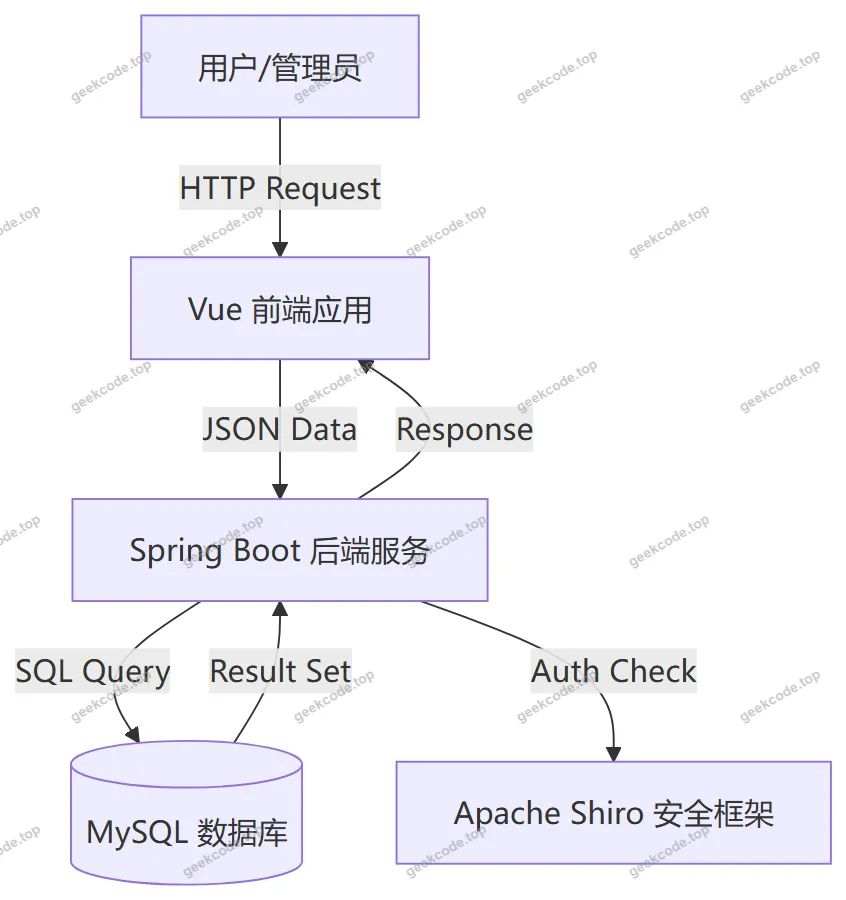</a>

<h2>功能模块</h2>

根据代码上下文中的 Controller 列表及截图功能展示，系统功能划分为前台用户端与后台管理端两大模块。

<h3>1. 前台用户端功能</h3>

面向普通注册用户，提供车辆浏览、租赁申请及个人数据管理服务。

<ul>
<li><strong>首页展示</strong>：轮播图展示、最新车辆推荐、系统公告入口。</li>
<li><strong>车辆信息浏览</strong>：</li>
<li><strong>车辆列表</strong>：按条件筛选查看可租车辆。</li>
<li><strong>车辆详情</strong>：查看车辆品牌、颜色、价格、图片及详细描述。</li>
<li><strong>基础数据展示</strong>：查看车辆品牌列表、车辆颜色列表。</li>
<li><strong>租赁业务流程</strong>：</li>
<li><strong>租赁订单</strong>：提交租赁申请，查看“租赁订单列表”及“租赁订单详情”。</li>
<li><strong>还车记录</strong>：查看历史“还车记录列表”及“还车记录详情”，确认归还状态。</li>
<li><strong>互动与社区</strong>：</li>
<li><strong>车辆评论</strong>：对车辆信息进行评价，查看“车辆信息评论列表”及“车辆信息评论详情”。</li>
<li><strong>系统公告</strong>：阅读平台发布的新闻通知，查看“系统公告列表”及“系统公告详情”。</li>
<li><strong>个人中心</strong>：</li>
<li><strong>个人信息</strong>：修改个人资料、密码等。</li>
<li><strong>我的收藏</strong>：管理已收藏的车辆，查看“我的收藏列表”。</li>
</ul>
<h3>2. 后台管理端功能</h3>

面向系统管理员，提供全量数据管理与业务审核功能。

<ul>
<li><strong>仪表盘首页</strong>：显示关键数据统计概览。</li>
<li><strong>用户管理</strong>：</li>
<li><strong>用户列表</strong>：增删改查注册用户的账号信息 (<code>/yonghu</code>, <code>/users</code>)。</li>
<li><strong>车辆基础数据管理</strong>：</li>
<li><strong>车辆品牌管理</strong>：维护品牌字典数据 (<code>/cheliangpinpai</code>)。</li>
<li><strong>车辆颜色管理</strong>：维护颜色字典数据 (<code>/cheliangyanse</code>)。</li>
<li><strong>车辆信息管理</strong>：录入、编辑、上架/下架车辆详细资料 (<code>/cheliangxinxi</code>)。</li>
<li><strong>业务订单管理</strong>：</li>
<li><strong>租赁订单管理</strong>：审核租赁申请，处理订单状态流转 (<code>/zulindingdanliebiao</code>)。</li>
<li><strong>还车记录管理</strong>：核查还车情况，处理异常还车记录 (<code>/haichejilu</code>)。</li>
<li><strong>内容与互动管理</strong>：</li>
<li><strong>系统公告管理</strong>：发布、编辑、删除平台新闻公告 (<code>/news</code>)。</li>
<li><strong>评论管理</strong>：审核用户提交的车辆评论，屏蔽违规内容 (<code>/discusscheliangxinxi</code>)。</li>
<li><strong>收藏管理</strong>：查看用户收藏数据 (<code>/storeup</code>)。</li>
<li><strong>系统配置</strong>：</li>
<li><strong>轮播图管理</strong>：配置首页展示的轮播广告图。</li>
<li><strong>系统参数配置</strong>：修改网站名称、Logo 等全局配置项 (<code>/config</code>)。</li>
</ul>
<h2>用户角色与权限</h2>

基于 Apache Shiro 框架及业务逻辑，系统主要包含以下两类角色：

<h3>1. 普通用户 (Yonghu)</h3>
<ul>
<li><strong>注册与登录</strong>：拥有创建账号及登录系统的权限。</li>
<li><strong>浏览权限</strong>：可公开访问车辆信息、品牌、颜色、系统公告及车辆评论列表。</li>
<li><strong>操作权限</strong>：</li>
<li>发起租赁订单。</li>
<li>查看自己的订单状态及还车记录。</li>
<li>发表车辆评论。</li>
<li>添加/取消车辆收藏。</li>
<li>编辑个人基本信息。</li>
<li><strong>限制</strong>：无法访问后台管理接口，无法修改其他用户数据或系统配置。</li>
</ul>
<h3>2. 管理员 (Admin)</h3>
<ul>
<li><strong>登录入口</strong>：通过独立的后台登录页进入管理系统。</li>
<li><strong>全量数据权限</strong>：拥有对所有业务表（车辆、订单、用户、公告等）的增、删、改、查权限。</li>
<li><strong>审核权限</strong>：负责审核租赁订单的有效性，处理还车争议，审核用户评论内容。</li>
<li><strong>配置权限</strong>：可管理系统全局配置（如轮播图、网站参数）。</li>
<li><strong>用户管理权限</strong>：可禁用或删除违规用户账号。</li>
</ul>
<h2>项目特色与创新点</h2>
<ol>
<li><strong>全流程闭环管理</strong>：系统不仅关注车辆信息的静态展示，更打通了“浏览-收藏-下单-租赁-还车-评价”的动态业务闭环，真实模拟了汽车租赁的核心商业逻辑。</li>
<li><strong>细粒度的数据字典管理</strong>：将“车辆品牌”与“车辆颜色”独立为单独的管理模块和展示页面，便于后期扩展新的车型属性，体现了良好的系统设计规范性。</li>
<li><strong>双向互动机制</strong>：引入了“车辆评论”与“我的收藏”功能，增强了用户粘性，同时为潜在租客提供了真实的参考依据，构建了初步的用户社区氛围。</li>
<li><strong>安全可靠的权限体系</strong>：基于 Shiro 框架实现了严格的身份认证与会话管理，有效隔离了前台用户与后台管理员的操作边界，保障了租赁交易数据的安全性与完整性。</li>
<li><strong>模块化后端设计</strong>：Controller 层清晰划分了业务领域（如 <code>HaichejiluController</code> 专门处理还车逻辑，<code>StoreupController</code> 处理收藏逻辑），代码结构高内聚低耦合，易于维护与二次开发。</li>
</ol>
<h2>部署环境</h2>

为确保系统正常运行，需准备以下软件环境：

<ul>
<li><strong>操作系统</strong>：Windows 10/11, macOS, 或 Linux (CentOS/Ubuntu)。</li>
<li><strong>Java 运行环境</strong>：JDK 1.8 或以上版本。</li>
<li><strong>数据库服务器</strong>：MySQL 5.7 或 MySQL 8.0+。</li>
<li><strong>构建工具</strong>：Maven 3.6+ (用于后端依赖管理)。</li>
<li><strong>前端运行环境</strong>：Node.js 14.x - 16.x (用于编译 Vue 前端代码)，npm 或 yarn。</li>
<li><strong>浏览器</strong>：Chrome, Edge, Firefox 等现代主流浏览器。</li>
<li><strong>IDE (开发阶段)</strong>：IntelliJ IDEA 或 Eclipse (后端), VS Code (前端)。</li>
</ul>
<h2>五、技术特性</h2>
<ul>
<li>前后端集成部署，前端资源打包至后端 static 目录</li>
<li>使用 MyBatis-Plus 简化数据访问层开发</li>
<li>集成 Shiro 权限框架实现角色权限控制</li>
</ul>
<h2>六、功能模块截图</h2>
<h3>前台用户端</h3>
<h4>前台首页</h4>

<a href="https://geekcode.top/archives/%E6%B1%BD%E8%BD%A6%E7%A7%9F%E8%B5%81%E7%B3%BB%E7%BB%9F?utm_source=github" title="查看完整源码">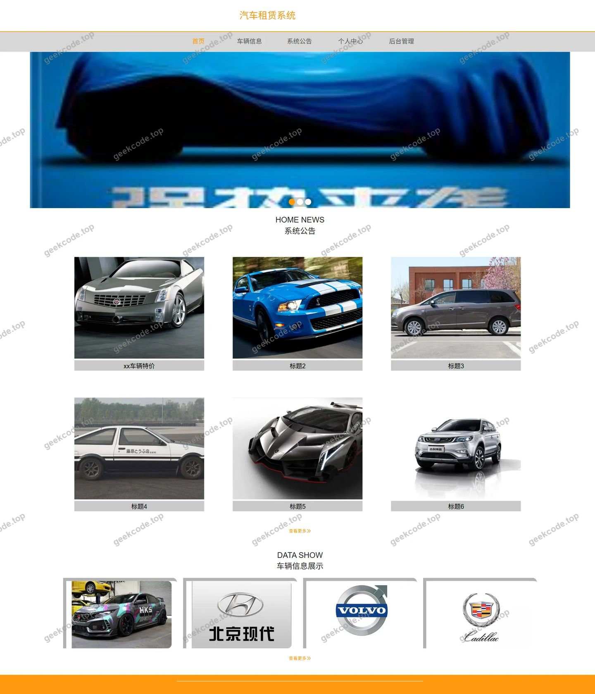</a>

<h4>前台登录页</h4>

<h4>前台注册页</h4>

<h4>前台-车辆信息列表</h4>

<a href="https://geekcode.top/archives/%E6%B1%BD%E8%BD%A6%E7%A7%9F%E8%B5%81%E7%B3%BB%E7%BB%9F?utm_source=github" title="查看完整源码">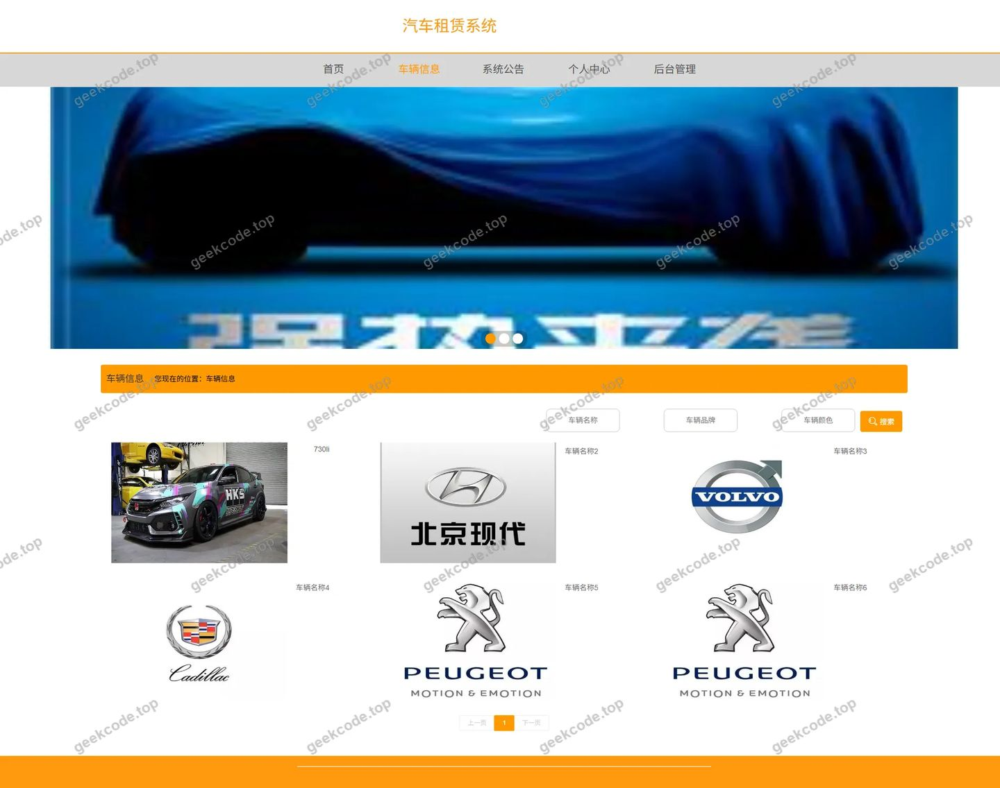</a>

<h4>前台-系统公告列表</h4>

<a href="https://geekcode.top/archives/%E6%B1%BD%E8%BD%A6%E7%A7%9F%E8%B5%81%E7%B3%BB%E7%BB%9F?utm_source=github" title="查看完整源码">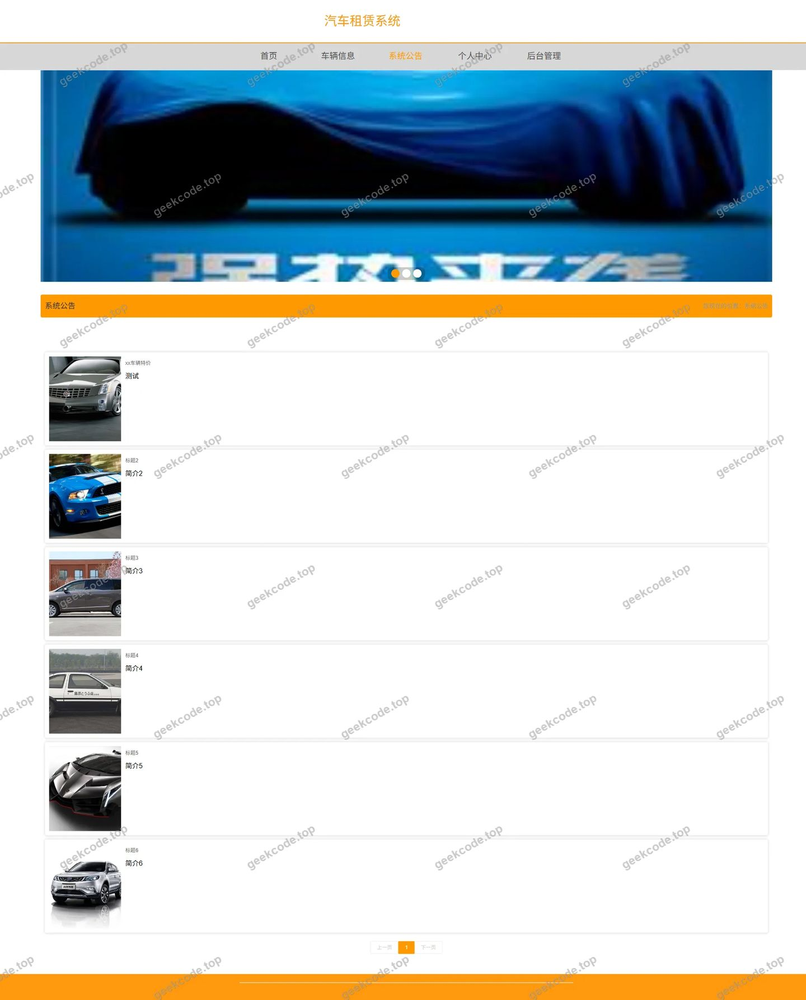</a>

<h4>前台-车辆信息评论列表</h4>

<h4>前台个人中心</h4>

<a href="https://geekcode.top/archives/%E6%B1%BD%E8%BD%A6%E7%A7%9F%E8%B5%81%E7%B3%BB%E7%BB%9F?utm_source=github" title="查看完整源码">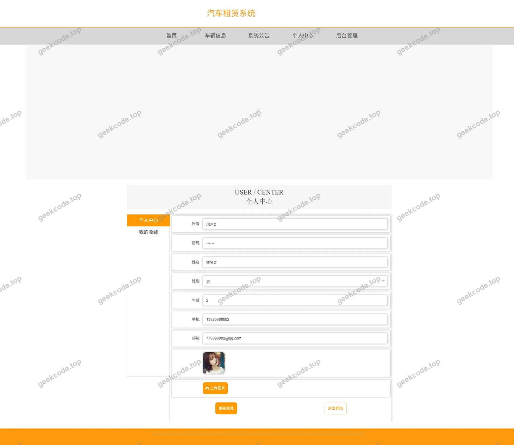</a>

<h4>前台-我的收藏列表</h4>

<a href="https://geekcode.top/archives/%E6%B1%BD%E8%BD%A6%E7%A7%9F%E8%B5%81%E7%B3%BB%E7%BB%9F?utm_source=github" title="查看完整源码">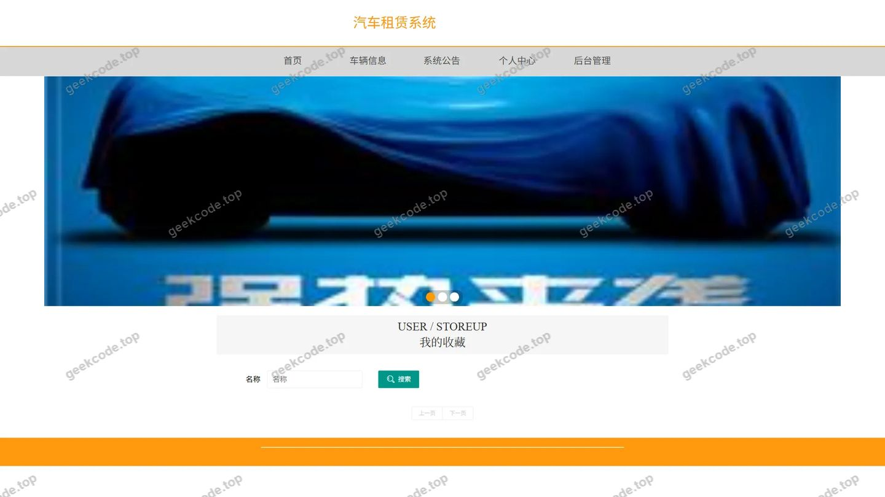</a>

<h4>前台-车辆信息-详情</h4>

<a href="https://geekcode.top/archives/%E6%B1%BD%E8%BD%A6%E7%A7%9F%E8%B5%81%E7%B3%BB%E7%BB%9F?utm_source=github" title="查看完整源码">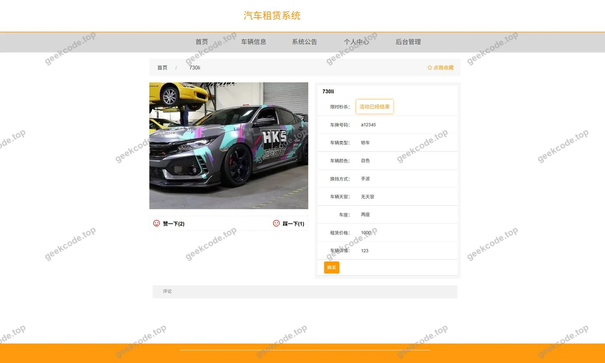</a>

<h4>前台-系统公告-详情</h4>

<a href="https://geekcode.top/archives/%E6%B1%BD%E8%BD%A6%E7%A7%9F%E8%B5%81%E7%B3%BB%E7%BB%9F?utm_source=github" title="查看完整源码">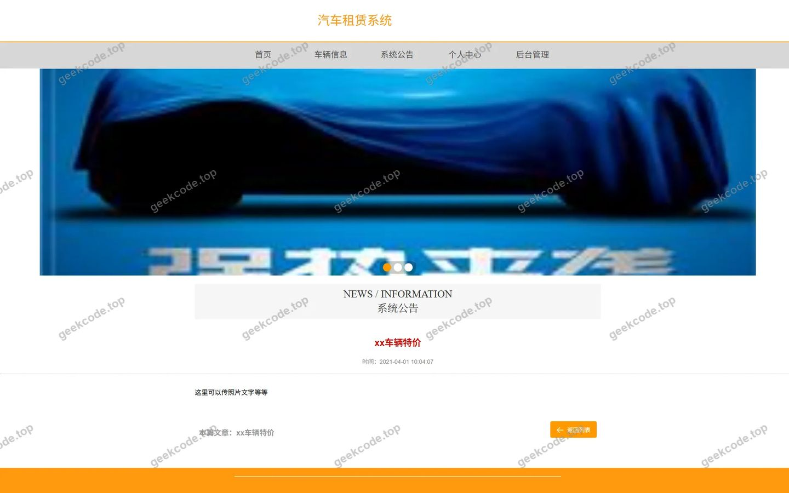</a>

<h4>前台-车辆品牌列表</h4>

<h4>前台-车辆颜色列表</h4>

<a href="https://geekcode.top/archives/%E6%B1%BD%E8%BD%A6%E7%A7%9F%E8%B5%81%E7%B3%BB%E7%BB%9F?utm_source=github" title="查看完整源码">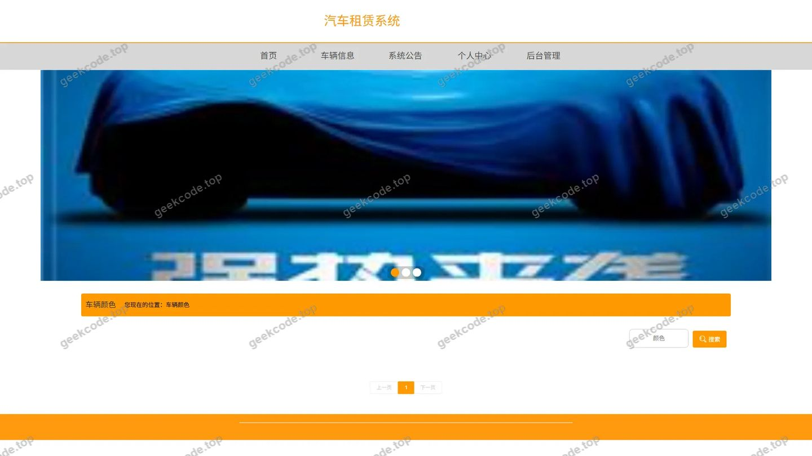</a>

<h4>前台-还车记录列表</h4>

<h4>前台-租赁订单列列表</h4>

<a href="https://geekcode.top/archives/%E6%B1%BD%E8%BD%A6%E7%A7%9F%E8%B5%81%E7%B3%BB%E7%BB%9F?utm_source=github" title="查看完整源码">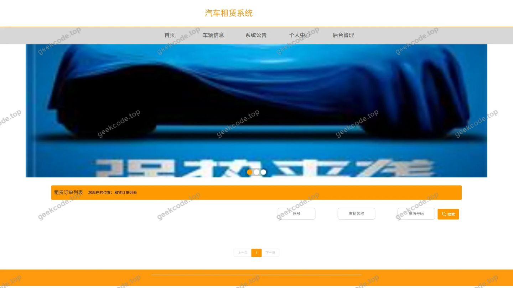</a>

<h4>前台-车辆信息评论-详情</h4>

<a href="https://geekcode.top/archives/%E6%B1%BD%E8%BD%A6%E7%A7%9F%E8%B5%81%E7%B3%BB%E7%BB%9F?utm_source=github" title="查看完整源码">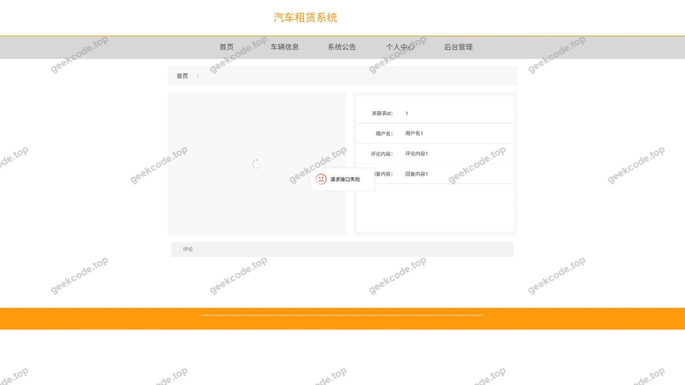</a>

<h4>前台-还车记录-详情</h4>

<a href="https://geekcode.top/archives/%E6%B1%BD%E8%BD%A6%E7%A7%9F%E8%B5%81%E7%B3%BB%E7%BB%9F?utm_source=github" title="查看完整源码">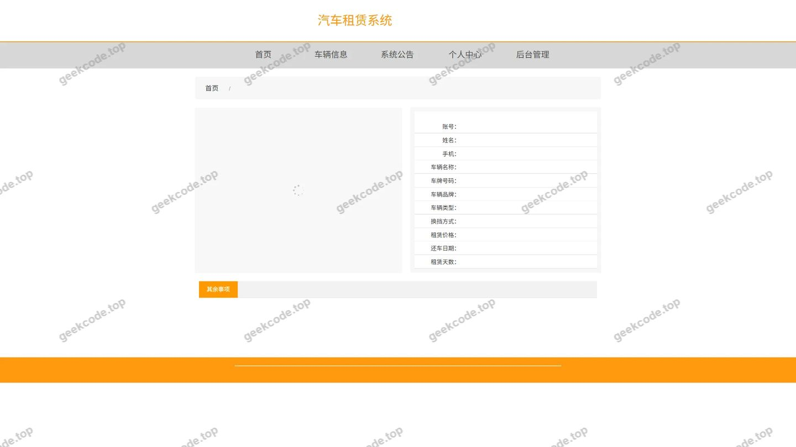</a>

<h4>前台-租赁订单列-详情</h4>

<a href="https://geekcode.top/archives/%E6%B1%BD%E8%BD%A6%E7%A7%9F%E8%B5%81%E7%B3%BB%E7%BB%9F?utm_source=github" title="查看完整源码">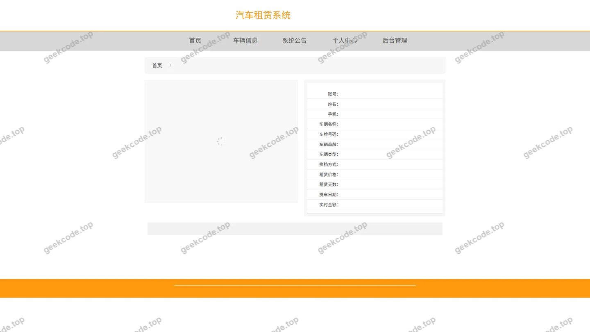</a>

<h3>后台管理端</h3>
<h4>后台-车辆品牌</h4>

<a href="https://geekcode.top/archives/%E6%B1%BD%E8%BD%A6%E7%A7%9F%E8%B5%81%E7%B3%BB%E7%BB%9F?utm_source=github" title="查看完整源码">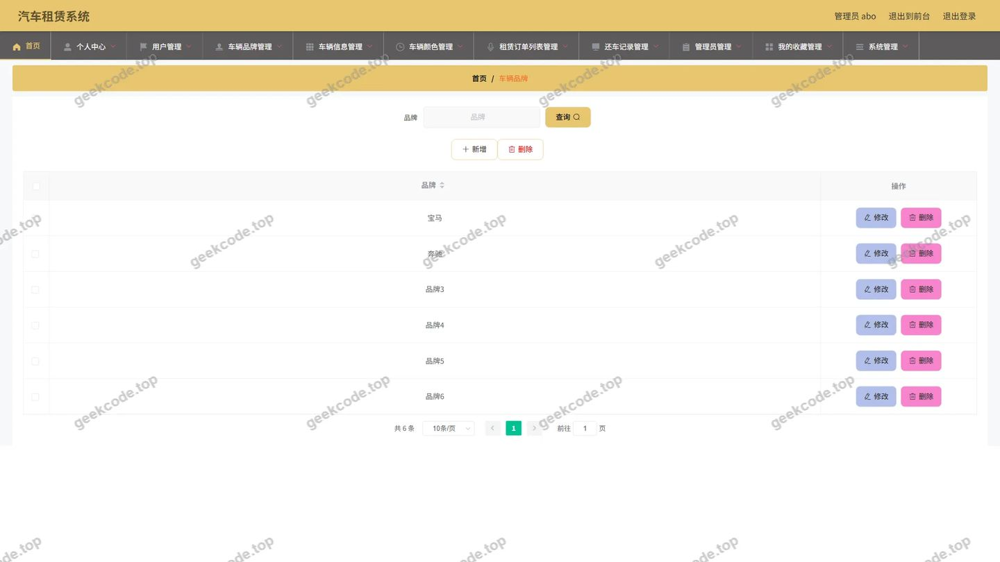</a>

<h4>后台-车辆信息</h4>

<a href="https://geekcode.top/archives/%E6%B1%BD%E8%BD%A6%E7%A7%9F%E8%B5%81%E7%B3%BB%E7%BB%9F?utm_source=github" title="查看完整源码">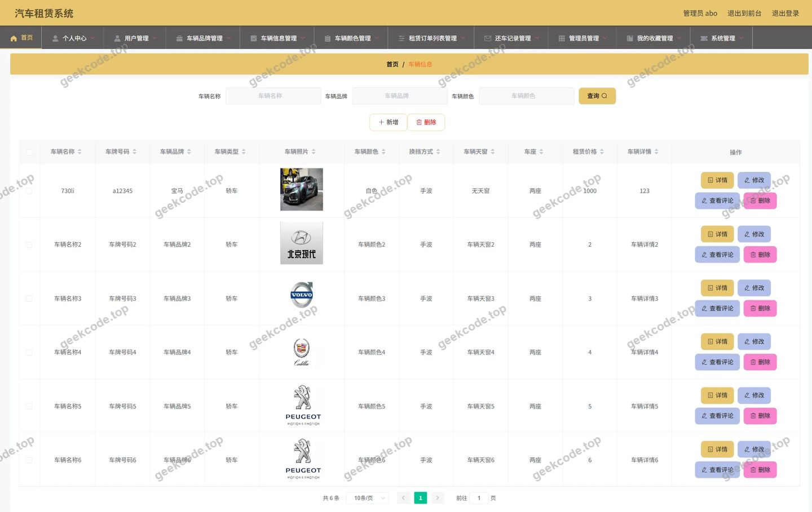</a>

<h4>后台-车辆颜色</h4>

<a href="https://geekcode.top/archives/%E6%B1%BD%E8%BD%A6%E7%A7%9F%E8%B5%81%E7%B3%BB%E7%BB%9F?utm_source=github" title="查看完整源码">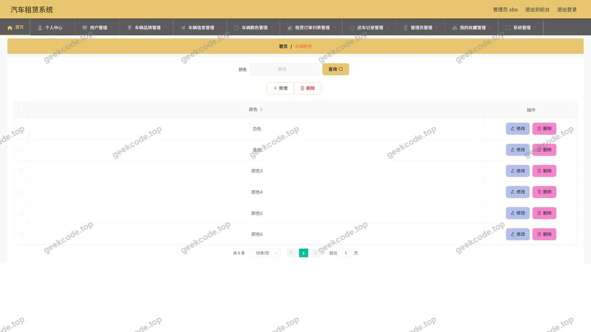</a>

<h4>后台-系统配置</h4>

<a href="https://geekcode.top/archives/%E6%B1%BD%E8%BD%A6%E7%A7%9F%E8%B5%81%E7%B3%BB%E7%BB%9F?utm_source=github" title="查看完整源码">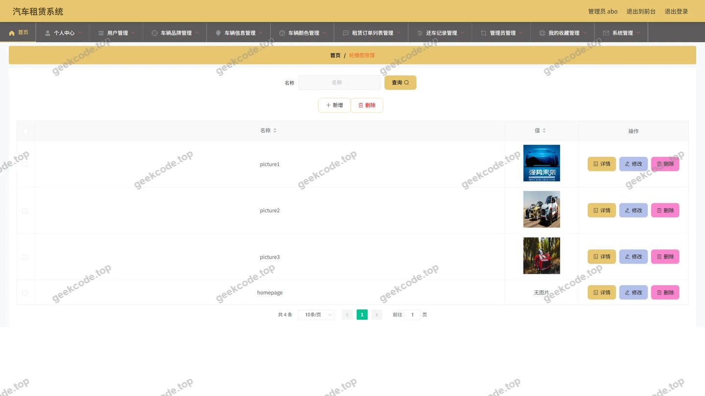</a>

<h4>后台-车辆信息评论</h4>

<a href="https://geekcode.top/archives/%E6%B1%BD%E8%BD%A6%E7%A7%9F%E8%B5%81%E7%B3%BB%E7%BB%9F?utm_source=github" title="查看完整源码">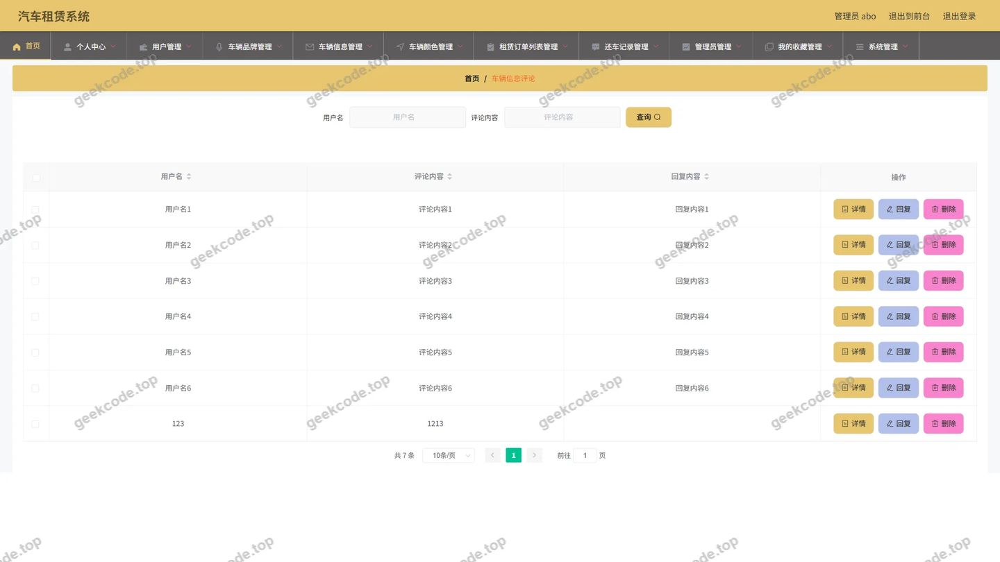</a>

<h4>后台-还车记录</h4>

<a href="https://geekcode.top/archives/%E6%B1%BD%E8%BD%A6%E7%A7%9F%E8%B5%81%E7%B3%BB%E7%BB%9F?utm_source=github" title="查看完整源码">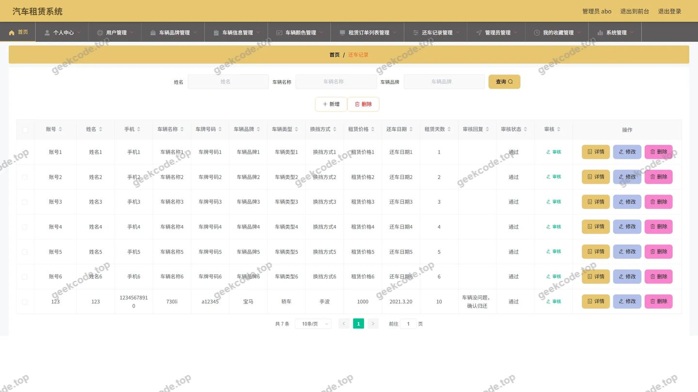</a>

<h4>后台首页</h4>

<a href="https://geekcode.top/archives/%E6%B1%BD%E8%BD%A6%E7%A7%9F%E8%B5%81%E7%B3%BB%E7%BB%9F?utm_source=github" title="查看完整源码">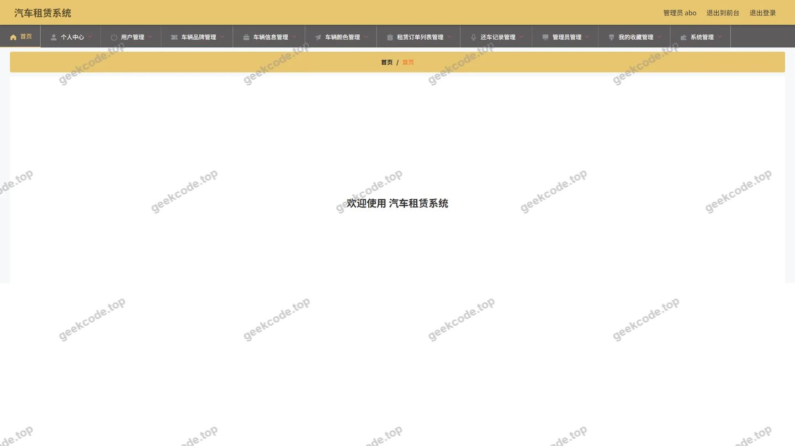</a>

<h4>后台-登录</h4>

<h4>后台-公告信息</h4>

<a href="https://geekcode.top/archives/%E6%B1%BD%E8%BD%A6%E7%A7%9F%E8%B5%81%E7%B3%BB%E7%BB%9F?utm_source=github" title="查看完整源码">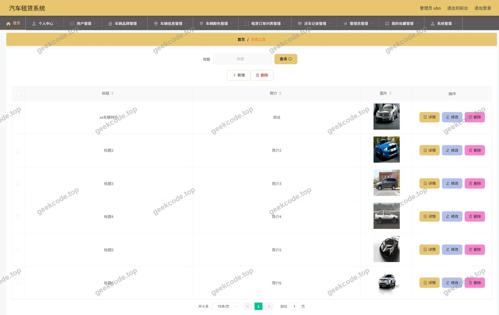</a>

<h4>后台-收藏</h4>

<a href="https://geekcode.top/archives/%E6%B1%BD%E8%BD%A6%E7%A7%9F%E8%B5%81%E7%B3%BB%E7%BB%9F?utm_source=github" title="查看完整源码">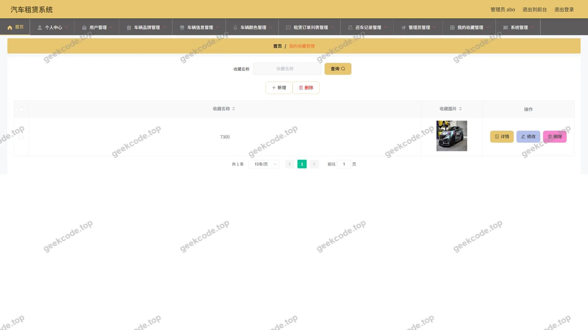</a>

<h4>后台-租赁订单列</h4>

<a href="https://geekcode.top/archives/%E6%B1%BD%E8%BD%A6%E7%A7%9F%E8%B5%81%E7%B3%BB%E7%BB%9F?utm_source=github" title="查看完整源码">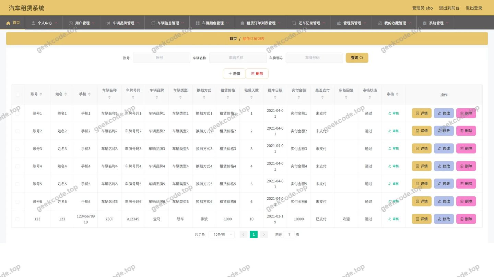</a>

---

## 获取完整源码

| 项目 | 说明 |
| --- | --- |
| 项目名 | 汽车租赁系统 |
| 运行截图 | 本文 29 张（站点带水印原图，仓库 `images/` 目录） |
| 完整源码 | [https://geekcode.top/archives/%E6%B1%BD%E8%BD%A6%E7%A7%9F%E8%B5%81%E7%B3%BB%E7%BB%9F?utm_source=github](https://geekcode.top/archives/%E6%B1%BD%E8%BD%A6%E7%A7%9F%E8%B5%81%E7%B3%BB%E7%BB%9F?utm_source=github) |
| 咨询微信 | **ir9372**（备注：jingpin-yuanma） |
| 更多项目 | [极客代码 geekcode.top](https://geekcode.top/?utm_source=github) |

> 需要源码、部署、改配置、跑不起来等问题，加微信 ir9372 沟通，说明项目名即可。
